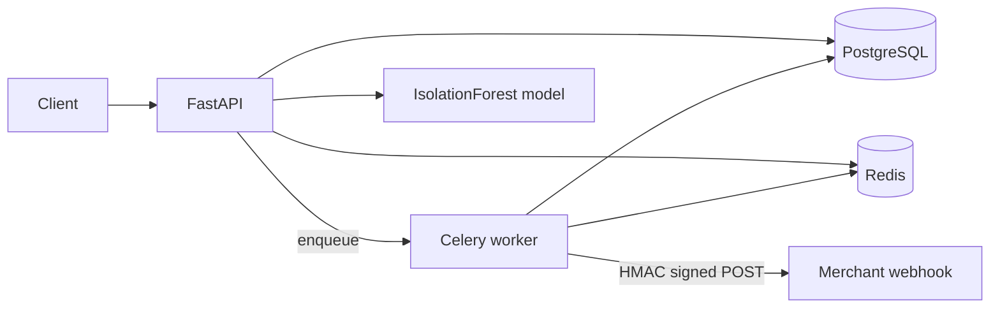

# PayGate — Codebase Guide

This document explains what PayGate is, how the system fits together, and what every important file in the repository does.

---

## What is PayGate?

PayGate is a **portfolio payments-style REST API**. It simulates how a merchant payment platform works end to end — without talking to a real card network or payment service provider.

It covers:

- Merchants, customers, payments, refunds, and webhook endpoints
- JWT dashboard users **and** hashed merchant API keys
- Role-based access control (`admin`, `merchant`, `readonly`)
- Idempotent POSTs via Redis
- Per-API-key rate limiting
- A payment status machine (`created` → `authorized` → `captured`, etc.)
- Locked refunds so concurrent refunds cannot exceed the capture amount
- Signed webhook delivery with retries (Celery + HMAC)
- An IsolationForest fraud score on every new payment

Money is stored as **integer minor units** (e.g. `10000` = ₹100.00), which avoids floating-point rounding.

---

## Tech stack

| Layer | Technology |
| --- | --- |
| API | Python ≥3.11, FastAPI, Uvicorn, Pydantic v2 |
| Database | PostgreSQL 16, SQLAlchemy 2 (async + asyncpg), Alembic |
| Cache / queues | Redis 7 (idempotency, rate limits, Celery broker) |
| Auth | PyJWT (HS256), passlib/bcrypt, SHA-256 hashed API keys |
| Workers | Celery + Redis, httpx for outbound webhooks |
| Fraud ML | scikit-learn IsolationForest, joblib, numpy |
| Tooling | pytest, ruff, Docker Compose, GitHub Actions |
| Load testing | k6, Locust, custom httpx runner |

---

## High-level architecture

```
Client
  → RequestIdMiddleware          (X-Request-Id + JSON access logs)
  → IdempotencyStoreMiddleware   (caches successful POST responses)
  → FastAPI route
        → resolve_auth           (JWT Bearer OR API key)
        → require(roles…)        (RBAC)
        → enforce_rate_limit     (API keys only; Redis sliding window)
        → enforce_idempotency    (optional Idempotency-Key on POST)
        → business logic         (AsyncSession → Postgres)
        → fraud.score_payment    (on payment create)
        → webhooks.enqueue_event → Celery deliver_webhook
```



### Typical payment-create flow

1. Authenticate as a merchant (API key or JWT with `merchant_id`).
2. Rate-limit by `api_key_id` if an API key was used.
3. If `Idempotency-Key` is present: Redis lookup — same body replays the cached response; different body → `422`.
4. Validate that the customer belongs to the merchant.
5. Score fraud (`risk_score`, `fraud_flagged` vs `FRAUD_THRESHOLD`). Fraud does **not** block creation; it only flags.
6. Persist a `Payment` with status `created`.
7. Enqueue `payment.created` webhook deliveries for matching endpoints.
8. On success, middleware stores the response under the idempotency key (TTL).

### Payment status machine

```
created  → authorized | cancelled | failed
authorized → captured | cancelled | failed
captured / failed / cancelled  →  (terminal — no further transitions)
```

Each transition emits a `payment.{status}` webhook event.

### Refunds

- Only allowed on `captured` payments.
- Uses `SELECT … FOR UPDATE` so concurrent refunds serialize on the payment row.
- Sum of refund amounts cannot exceed the original capture.
- Emits `refund.created`.

### Webhooks

- HMAC-SHA256 over `{timestamp}.` + raw body.
- Headers: `X-Signature`, `X-Timestamp`, `X-Event-Type`.
- Exponential backoff + jitter; max attempts from settings.

---

## Repository layout

```
PayGate/
├── app/                  # Application source (FastAPI)
│   ├── routers/          # HTTP route modules
│   └── …                 # Core modules (auth, fraud, DB, etc.)
├── artifacts/            # Trained fraud model (joblib)
├── loadtest/             # k6 / Locust / httpx load scripts
├── migrations/           # Alembic schema migrations
├── scripts/              # Seed data + fraud training CLI
├── tests/                # pytest suite
├── .github/workflows/    # CI pipeline
├── docker-compose.yml    # Local stack (API, worker, Postgres, Redis)
├── Dockerfile
├── Makefile
├── pyproject.toml        # Dependencies, pytest, ruff, coverage
├── .env.example          # Documented environment variables
├── README.md             # Quick start & feature overview
└── CODEBASE.md           # This file
```

---

## API endpoints

| Method | Path | Auth | Notes |
| --- | --- | --- | --- |
| `GET` | `/health` | none | Liveness |
| `GET` | `/ready` | none | Postgres + Redis readiness |
| `POST` | `/auth/register` | admin | Create dashboard user |
| `POST` | `/auth/login` | none | Returns JWT |
| `GET` | `/auth/me` | user JWT | Current user profile |
| `POST` | `/merchants` | admin | Create merchant |
| `GET` | `/merchants` | admin | Cursor-paginated list |
| `GET` | `/merchants/{id}` | admin/merchant/readonly | Tenant-scoped |
| `PATCH` | `/merchants/{id}` | admin | Update merchant |
| `POST` | `/merchants/{id}/api-keys` | admin/merchant | Plaintext key shown once |
| `GET` | `/merchants/{id}/api-keys` | admin/merchant | List keys (hashed only) |
| `POST` | `/customers` | admin/merchant | Create customer |
| `GET` | `/customers` | admin/merchant/readonly | List customers |
| `GET` | `/customers/{id}` | admin/merchant/readonly | Get customer |
| `POST` | `/payments` | admin/merchant | Create + fraud + webhook |
| `GET` | `/payments` | admin/merchant/readonly | Filters: status, amount, dates |
| `GET` | `/payments/{id}` | admin/merchant/readonly | Get payment |
| `POST` | `/payments/{id}/authorize` | admin/merchant | Status transition |
| `POST` | `/payments/{id}/capture` | admin/merchant | Status transition |
| `POST` | `/payments/{id}/cancel` | admin/merchant | Status transition |
| `POST` | `/payments/{id}/fail` | admin/merchant | Status transition |
| `POST` | `/refunds` | admin/merchant | Partial/full refund |
| `GET` | `/refunds` | admin/merchant/readonly | Optional `payment_id` filter |
| `GET` | `/refunds/{id}` | admin/merchant/readonly | Get refund |
| `POST` | `/webhook-endpoints` | admin/merchant | Register callback URL |
| `GET` | `/webhook-endpoints` | admin/merchant/readonly | List endpoints |
| `GET` | `/webhook-endpoints/{id}` | admin/merchant/readonly | Get endpoint |
| `PATCH` | `/webhook-endpoints/{id}` | admin/merchant | Update endpoint |
| `GET` | `/webhook-deliveries` | admin/merchant/readonly | Delivery history |
| `GET` | `/webhook-deliveries/{id}` | admin/merchant/readonly | Get delivery |

Interactive OpenAPI docs: `http://localhost:8000/docs` when the API is running.

---

## Domain model

**Roles:** `admin` · `merchant` · `readonly`

**Payment statuses:** `created` · `authorized` · `captured` · `failed` · `cancelled`

**Delivery statuses:** `pending` · `success` · `failed`

**Entities and relationships:**

```
Merchant
  ├── ApiKey
  ├── Customer
  ├── Payment ── Refund
  └── WebhookEndpoint ── WebhookDelivery

User  (optional merchant_id for tenant scoping)
IdempotencyRecord  (Postgres table exists; runtime idempotency uses Redis)
```

---

## File-by-file reference

### `app/` — core application

#### `app/main.py`

FastAPI application entry point.

- Builds the app, registers exception handlers, mounts routers.
- **`RequestIdMiddleware`** — assigns/propagates `X-Request-Id` and logs JSON access lines with duration.
- **`IdempotencyStoreMiddleware`** — after successful 2xx POSTs, stores the response body for later replay.
- **`lifespan`** — configures logging, connects Redis, loads the fraud model, disposes connections on shutdown.
- **`/health`** — always returns ok (liveness).
- **`/ready`** — pings Postgres and Redis (readiness).

#### `app/config.py`

Central configuration via `pydantic-settings`.

- Reads `.env` and environment variables into a `Settings` object.
- Covers JWT, database/Redis/Celery URLs, idempotency TTL, rate limits, fraud path/threshold, webhook retry/timeout, cursor page sizes, and seed flag.
- `get_settings()` is an `@lru_cache` singleton used across the app.

#### `app/db.py`

Database and Redis connection layer.

- Async SQLAlchemy `engine` / `SessionLocal` for PostgreSQL.
- `Base` — declarative base for all ORM models.
- `get_db` — FastAPI dependency that yields an `AsyncSession`.
- `get_redis` / `close_redis` — lazy Redis client lifecycle.

#### `app/models.py`

SQLAlchemy ORM models and domain enums.

| Model | Purpose |
| --- | --- |
| `User` | Dashboard login accounts with role + optional merchant |
| `Merchant` | Tenant that owns customers, payments, keys, webhooks |
| `ApiKey` | Hashed merchant API key (`key_prefix` + `key_hash`) |
| `Customer` | Payer under a merchant (unique email per merchant) |
| `Payment` | Money movement record with status, risk score, metadata |
| `Refund` | Partial or full refund against a captured payment |
| `WebhookEndpoint` | Merchant callback URL + secret + event filter |
| `WebhookDelivery` | One delivery attempt history for an event |
| `IdempotencyRecord` | Optional durable store (not used at runtime today) |

Also defines `TimestampMixin` (`created_at` / `updated_at`) and the enums above.

#### `app/schemas.py`

Pydantic request/response DTOs used for validation and OpenAPI.

- Auth, merchant, API key, customer, payment, refund, and webhook schemas.
- Shared `ORMModel` base and generic cursor `Page[T]`.
- Some update schemas exist for completeness but are not all wired to routes.

#### `app/deps.py`

Authentication and authorization dependencies.

- **`AuthContext`** — resolved caller: role, user id, merchant id, api key id.
- **`resolve_auth`** — accepts JWT Bearer **or** API key (`X-Api-Key` or Bearer starting with `pg_` / `pg_live_`).
- **`require(*roles)`** — returns 403 if the caller's role is not allowed.
- Typed aliases: `DbDep`, `RedisDep`, `AuthDep`.

#### `app/security.py`

Crypto and credential helpers.

| Function | Role |
| --- | --- |
| `hash_password` / `verify_password` | bcrypt for dashboard users |
| `create_access_token` / `decode_access_token` | JWT issue/verify |
| `generate_api_key` / `hash_api_key` | Create + store merchant keys |
| `hmac_sign` / `hmac_verify` | Webhook signature |
| `request_body_hash` | SHA-256 of body for idempotency matching |

#### `app/fraud.py`

IsolationForest fraud scoring.

- Features: `log1p(amount)`, hour of day, currency code.
- `train_and_save` — trains on synthetic data and writes `artifacts/fraud_model.joblib`.
- `load_model` — loads at API startup (or lazily).
- `score_payment` — returns `(risk_score 0–1, fraud_flagged)`. If no model is loaded, returns `(0.0, False)`.

#### `app/idempotency.py`

Redis-backed POST idempotency.

- **`enforce_idempotency`** — dependency: if key exists with same body hash → raise `IdempotentReplay`; different hash → conflict error.
- **`IdempotencyStoreMiddleware`** — caches successful responses under the key with TTL.
- Runtime storage is **Redis only**. The Postgres `IdempotencyRecord` table is migrated but not written by app code today.

#### `app/ratelimit.py`

Per-API-key sliding-window rate limit (Redis sorted set).

- Sets `X-RateLimit-*` headers on allowed requests.
- Returns `429` + `Retry-After` when the window is exceeded.
- **JWT-only callers are not rate-limited** (`api_key_id` is `None`).

#### `app/errors.py`

Uniform error envelope: `{ "code", "message", "details" }`.

- `AppError` for application-level failures.
- Registers handlers for `AppError`, `HTTPException`, validation errors (`422`), and unhandled exceptions (`500`).

#### `app/base.py`

Shared list/filter/pagination helpers and generic CRUD.

- Cursor encode/decode over `(created_at, id)`.
- `apply_filters` — equality and range operators (`__gte`, `__lte`, etc.).
- `paginate_stmt` — descending cursor pagination.
- `CRUDService` — get / list / create / update / delete used by several routers.

#### `app/webhooks.py`

Outbound webhook enqueue and Celery delivery.

| Symbol | Role |
| --- | --- |
| `celery_app` | Celery application (`paygate.deliver_webhook`) |
| `backoff_delay` | Exponential delay + jitter, capped by settings |
| `generate_webhook_secret` | Secret for new endpoints |
| `enqueue_event` | Creates `WebhookDelivery` rows; schedules Celery (or sync fallback in test / broker failure) |
| `attempt_delivery` | HMAC-signed httpx POST; updates attempts/status; schedules retry |
| `deliver_webhook` | Celery task entrypoint |

---

### `app/routers/` — HTTP routes

#### `app/routers/auth.py`

Prefix `/auth`.

- `POST /register` — admin creates a user.
- `POST /login` — email/password → JWT.
- `GET /me` — current user from JWT.

#### `app/routers/merchants.py`

Merchant, API key, and customer management.

- Admin-heavy merchant CRUD with tenant scoping for merchant/readonly roles.
- API key create/list (plaintext shown only on create).
- Customer create/list/get scoped to the caller's merchant.

#### `app/routers/payments.py`

Payment lifecycle API.

- Create (fraud scoring + `payment.created` webhook).
- List with filters (status, amount, created_at range) and cursor pagination.
- Get by id.
- `authorize` / `capture` / `cancel` / `fail` via a transition map (`TRANSITIONS`).
- Rate limit + idempotency on mutating routes.

#### `app/routers/refunds.py`

Refund create/list/get.

- Create locks the payment row, checks captured status and remaining refundable amount, then enqueues `refund.created`.
- List supports optional `payment_id` filter.

#### `app/routers/webhooks.py`

Webhook **management** API (register endpoints, inspect deliveries).

- Outbound send logic lives in `app/webhooks.py`, not here.
- Create endpoint generates a secret; list/get deliveries for debugging.

---

### `scripts/`

| File | What it does |
| --- | --- |
| `scripts/seed.py` | Idempotent demo data: Demo Merchant, admin + merchant users, demo API key. Prints `DEMO_API_KEY` / `DEMO_MERCHANT_ID` once (also visible in `docker compose logs migrate`). |
| `scripts/train_fraud.py` | CLI wrapper around `fraud.train_and_save()`; writes the joblib artifact. |

Default seed credentials (local/demo only):

- Admin: `admin@paygate.test` / `adminpass123`
- Merchant: `demo@paygate.test` / `demopass123`

---

### `tests/`

| File | What it covers |
| --- | --- |
| `conftest.py` | Test env, DB create/drop, Redis flush, ASGI client, shared fixtures, webhook sync mode |
| `test_health.py` | `/health`, `/ready` |
| `test_auth_rbac.py` | RBAC matrix, login/me, invalid API key |
| `test_merchants_auth.py` | Merchant/API key/customer/webhook CRUD, validation shape |
| `test_payments.py` | Full payment lifecycle, invalid transitions, list filters |
| `test_refunds.py` | Partial/full refunds, concurrent over-limit protection |
| `test_idempotency.py` | Replay + body-hash conflict |
| `test_fraud.py` | Flagging and score on create |
| `test_webhooks.py` | HMAC success path + retry-until-failure (fake httpx) |
| `test_ratelimit.py` | `429` when limit exceeded |
| `test_security_utils.py` | HMAC roundtrip, body hash, backoff growth |
| `test_base_utils.py` | Cursor helpers, CRUD edges, fraud without model |
| `test_extra_coverage.py` | Edge auth headers, pagination, cross-tenant 403, Celery task wiring |

Coverage gate: **85%** minimum (`pyproject.toml` / CI). Run with `make test`.

---

### `loadtest/`

| File | Role |
| --- | --- |
| `payments.js` | k6 script: create / get / list payments; used by `make load` |
| `locustfile.py` | Locust user with weighted create/get/list |
| `run_load.py` | Async httpx VU runner; prints RPS, error rate, p50/p95/p99 |

All expect `API_KEY` and `CUSTOMER_ID` (and optional `BASE_URL`).

---

### `migrations/`

| File | Role |
| --- | --- |
| `env.py` | Async Alembic environment; DB URL from settings; imports models for metadata |
| `versions/6472c097c7b8_initial.py` | Initial schema: all tables, enums, indexes |
| `script.py.mako` | Template for new Alembic revisions |

Config file at repo root: `alembic.ini` (`script_location = migrations`).

---

### Docker, CI, and project tooling

| File | Role |
| --- | --- |
| `Dockerfile` | Multi-stage build: install package, copy app/migrations/scripts/artifacts, train fraud model, run Uvicorn as user `paygate` |
| `docker-compose.yml` | `postgres` (:5433), `redis`, one-shot `migrate` (alembic + seed), `api`, `worker`; optional `postgres-test` / `redis-test` profile for pytest |
| `Makefile` | `up`, `down`, `migrate`, `train`, `lint`, `test`, `load` |
| `.github/workflows/ci.yml` | On push/PR: services → install → train → ruff → pytest cov → Codecov → Docker build |
| `pyproject.toml` | Package metadata, runtime/dev deps, pytest/coverage/ruff config |
| `.env.example` | Template for all settings (copy to `.env`) |
| `README.md` | Quick start, features, design trade-offs, load-test notes |

---

## Module dependency map

```
main
 ├─ middleware: RequestId, IdempotencyStore
 ├─ routers
 │    → deps (resolve_auth / require) → security + models + db
 │    ├─ payments → fraud, ratelimit, idempotency, webhooks
 │    ├─ refunds  → ratelimit, idempotency, webhooks
 │    ├─ webhooks router → webhooks.generate_webhook_secret
 │    ├─ merchants → security.generate_api_key, base.CRUDService
 │    └─ auth → security (JWT / passwords)
 ├─ fraud (artifacts/fraud_model.joblib)
 ├─ webhooks → Celery + httpx + SessionLocal
 └─ errors (global handlers)
```

---

## Environment variables

Documented in `.env.example`. Important ones:

| Variable | Purpose |
| --- | --- |
| `SECRET_KEY` | JWT signing secret |
| `DATABASE_URL` | Async Postgres URL (`postgresql+asyncpg://…`) |
| `REDIS_URL` | Redis for idempotency + rate limits |
| `CELERY_BROKER_URL` / `CELERY_RESULT_BACKEND` | Celery Redis DBs |
| `IDEMPOTENCY_TTL_SECONDS` | How long cached POST responses live |
| `RATE_LIMIT_REQUESTS` / `RATE_LIMIT_WINDOW_SECONDS` | Sliding window |
| `FRAUD_THRESHOLD` / `FRAUD_MODEL_PATH` | Fraud flag cutoff + model file |
| `WEBHOOK_MAX_ATTEMPTS` / delay / timeout | Delivery retry policy |
| `API_KEY_PREFIX` | Prefix for generated keys (`pg_live_`) |
| `SEED_DEMO` | Whether migrate/seed creates demo data |

---

## Design notes worth knowing

1. **No real payment provider** — authorize/capture/cancel/fail are local state-machine updates only.
2. **Idempotency is Redis-only** at runtime; the Postgres table is reserved for a possible durable option later.
3. **Rate limits apply to API-key auth**, not pure JWT sessions.
4. **Fraud never blocks payment creation** — it only sets `risk_score` / `fraud_flagged`.
5. **Webhook delivery** uses Celery in normal environments; falls back to inline delivery if `.delay()` fails or when `environment=test`.
6. **Money is always integer minor units** — callers convert display amounts themselves.

---

## How to run (short)

```bash
cp .env.example .env
make train   # train IsolationForest → artifacts/
make up      # docker compose up --build -d
```

- API + docs: `http://localhost:8000/docs`
- Demo API key: `docker compose logs migrate`
- Tests: `make test`
- Lint: `make lint`

For more curl examples, design trade-offs, and load-test results, see [README.md](README.md).
