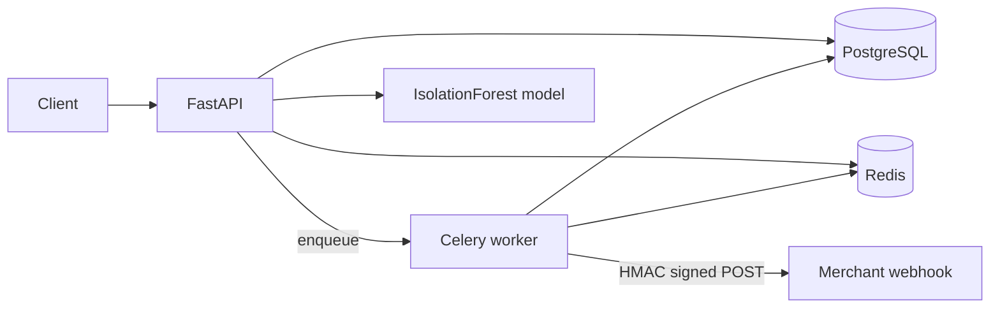

# PayGate

PayGate is a portfolio payments-style REST API that simulates merchant money movement end to end: JWT and hashed API-key auth, RBAC, idempotent POSTs, Redis rate limits, a payment status machine, locked refunds, signed webhook delivery with retries, and a small IsolationForest fraud score — without talking to a real payment provider.


> Replace `OWNER` in the CI badge URL with your GitHub username/org after pushing the repo.

## Architecture



## Prerequisites

| Tool | Version / notes |
| --- | --- |
| Docker + Docker Compose | Required for the full stack (Postgres, Redis, API, Celery worker) |
| Python | ≥ 3.11 (local run / tests / lint) |
| Make | Optional; every `make` target below also has a raw command |
| k6 | Optional; only for the Docker-based load test |

On Windows, run Make from Git Bash / WSL, or use the equivalent `docker compose` / `pytest` commands shown in each section.

---

## End-to-end setup (recommended: Docker)

This brings up Postgres, Redis, migrations + demo seed, the API, and the Celery worker.

### 1. Clone and configure env

```bash
git clone https://github.com/OWNER/PayGate.git
cd PayGate
cp .env.example .env
```

Edit `.env` if needed. Defaults match the Compose stack for local work (`DATABASE_URL` uses host port `5433`, Redis on `6379`). Compose services set their own env internally; `.env` matters most for **local** (non-Compose) runs.

### 2. Train the fraud model

```bash
make train
# or:
python scripts/train_fraud.py
```

Writes `artifacts/fraud_model.joblib`. The Docker image also trains during build (`|| true` if artifacts are missing).

### 3. Start the stack

```bash
make up
# or:
docker compose up --build -d
```

Services:

| Service | Role |
| --- | --- |
| `postgres` | PostgreSQL 16 on host port **5433** |
| `redis` | Redis 7 on host port **6379** |
| `migrate` | `alembic upgrade head` + `python scripts/seed.py` (exits when done) |
| `api` | Uvicorn on **http://localhost:8000** |
| `worker` | Celery webhook delivery worker |

### 4. Verify

```bash
curl -s http://localhost:8000/health
curl -s http://localhost:8000/ready
```

- OpenAPI docs: [http://localhost:8000/docs](http://localhost:8000/docs)
- Demo API key (printed once by seed):

```bash
docker compose logs migrate
```

Look for `DEMO_API_KEY=...` and `DEMO_MERCHANT_ID=...`.

### Demo credentials (from seed)

| Account | Email | Password |
| --- | --- | --- |
| Admin | `admin@paygate.test` | `adminpass123` |
| Merchant | `demo@paygate.test` | `demopass123` |

### Stop / reset

```bash
make down
# or:
docker compose down -v
```

`-v` removes the Postgres volume (full data reset).

---

## Local development setup (API on host)

Use this when you want to run Uvicorn / Celery on the host against Dockerized Postgres + Redis.

### 1. Env + dependencies

```bash
cp .env.example .env
python -m venv .venv

# Linux / macOS / Git Bash:
source .venv/bin/activate

# Windows PowerShell:
# .\.venv\Scripts\Activate.ps1

pip install -e ".[dev]"
python scripts/train_fraud.py
```

### 2. Start infrastructure only

```bash
docker compose up -d postgres redis
```

Wait until healthy, then migrate and seed:

```bash
make migrate
# or:
alembic upgrade head

python scripts/seed.py
```

### 3. Run API and worker

```bash
uvicorn app.main:app --reload --host 0.0.0.0 --port 8000
```

In a second terminal (same venv + `.env`):

```bash
celery -A app.webhooks.celery_app worker --loglevel=INFO
```

API: [http://localhost:8000/docs](http://localhost:8000/docs)

---

## How to run (quick reference)

| Goal | Command |
| --- | --- |
| Full stack (Docker) | `make up` → `docker compose up --build -d` |
| Stop stack + wipe DB | `make down` → `docker compose down -v` |
| Migrations only | `make migrate` → `alembic upgrade head` |
| Train fraud model | `make train` → `python scripts/train_fraud.py` |
| Seed demo data | `python scripts/seed.py` |
| API (host) | `uvicorn app.main:app --reload --port 8000` |
| Celery worker (host) | `celery -A app.webhooks.celery_app worker --loglevel=INFO` |
| Health / ready | `curl http://localhost:8000/health` · `curl http://localhost:8000/ready` |

---

## How to test

Tests use **pytest** with Postgres (`paygate_test` on `localhost:5433`) and Redis (`localhost:6379`). `tests/conftest.py` creates the test database and tables automatically.

### Option A — Makefile (starts test-profile containers, then pytest)

```bash
make test
# equivalent:
docker compose --profile test up -d postgres-test redis-test
pytest --cov=app --cov-report=term-missing --cov-fail-under=85 -q
```

> Tests expect Redis on **port 6379** (see `tests/conftest.py` / CI). If you already have the main stack up (`make up`), Redis on 6379 is fine — you can run pytest directly without the test profile.

### Option B — Pytest only (infra already running)

With Postgres + Redis available (e.g. after `docker compose up -d postgres redis`):

```bash
pip install -e ".[dev]"
python scripts/train_fraud.py
pytest --cov=app --cov-report=term-missing --cov-fail-under=85 -q
```

### Useful pytest variants

```bash
# Single file
pytest tests/test_payments.py -q

# Single test
pytest tests/test_refunds.py::test_concurrent_refunds_cannot_overshoot -q

# Verbose + show locals on failure
pytest -vv --tb=short

# Coverage HTML report
pytest --cov=app --cov-report=html --cov-fail-under=85 -q
# open htmlcov/index.html
```

Proven locally: **51 passed**, **coverage 91%** (greenlet-aware). Coverage includes idempotency replay/conflict, rate-limit 429, RBAC matrix, invalid transitions, concurrent refund over-limit, webhook signature + retry failure, and fraud flag.

### Lint

```bash
make lint
# or:
ruff check app tests scripts
ruff format --check app tests scripts

# Auto-fix style (optional)
ruff check --fix app tests scripts
ruff format app tests scripts
```

### What CI runs

See [`.github/workflows/ci.yml`](.github/workflows/ci.yml): install `.[dev]`, train fraud model, ruff, pytest with coverage (≥85%), Docker image build.

---

## Features

- Merchants, customers, payments, refunds, webhook endpoints, webhook deliveries
- JWT dashboard users + hashed merchant API keys (plaintext shown once)
- RBAC via reusable `require(role, ...)` dependency (`admin`, `merchant`, `readonly`)
- Idempotency-Key on POSTs (Redis TTL; same body replays, different body → 422)
- Per-API-key sliding-window rate limit (429 + `Retry-After` + `X-RateLimit-*`)
- Payments: create/get/list (cursor + filters), authorize/capture/cancel/fail
- Refunds: partial/full with `SELECT … FOR UPDATE` so concurrent refunds cannot exceed capture
- Webhooks: HMAC-SHA256 (`X-Signature` + `X-Timestamp`), exponential backoff + jitter, max attempts from settings
- Fraud score on every payment (`risk_score`, `fraud_flagged`)
- Consistent `{code, message, details}` errors, `/health` + `/ready`, JSON logs with request id
- OpenAPI examples on main schemas

## API examples

```bash
export API_KEY=pg_live_...
export CUSTOMER_ID=...

# Login (JWT)
curl -s -X POST http://localhost:8000/auth/login \
  -H "Content-Type: application/json" \
  -d '{"email":"demo@paygate.test","password":"demopass123"}'

# Create customer
curl -s -X POST http://localhost:8000/customers \
  -H "Authorization: Bearer $API_KEY" \
  -H "Content-Type: application/json" \
  -d '{"email":"buyer@example.com","name":"Buyer"}'

# Create payment
curl -s -X POST http://localhost:8000/payments \
  -H "Authorization: Bearer $API_KEY" \
  -H "Idempotency-Key: order-1001" \
  -H "Content-Type: application/json" \
  -d "{\"customer_id\":\"$CUSTOMER_ID\",\"amount_minor\":10000,\"currency\":\"INR\"}"

# Replay with the same key and body (cached response)
curl -s -X POST http://localhost:8000/payments \
  -H "Authorization: Bearer $API_KEY" \
  -H "Idempotency-Key: order-1001" \
  -H "Content-Type: application/json" \
  -d "{\"customer_id\":\"$CUSTOMER_ID\",\"amount_minor\":10000,\"currency\":\"INR\"}"
```

Webhook payload + signature verification:

```python
import hashlib, hmac, json

def verify(secret: str, timestamp: str, body: bytes, signature: str) -> bool:
    message = f"{timestamp}.".encode() + body
    expected = hmac.new(secret.encode(), message, hashlib.sha256).hexdigest()
    return hmac.compare_digest(expected, signature)

# headers: X-Signature, X-Timestamp
# body example:
# {"id":"...", "type":"payment.created", "data":{...}, "created_at":"..."}
```

## Design decisions

| Choice | Trade-off |
| --- | --- |
| Idempotency in Redis | Fast TTL cache for hot keys; loses durability if Redis is wiped. Postgres table exists as a longer-term option. |
| `FOR UPDATE` on refunds | Serializes refunds per payment so concurrent partial refunds cannot overshoot capture; adds lock wait under contention. |
| Webhook backoff + jitter | Spreads retries away from thundering herds; delayed delivery vs. immediate fail-fast. Celery countdown schedules retries. |
| Money as integer minor units | Avoids float rounding; callers must convert display amounts. |
| Generic CRUD base | Less duplication; unusual resource behavior stays in routers. |

## Load testing

Machine: Windows 11 Pro, 11th Gen Intel Core i7-1165G7 (4 cores / 8 threads), 16 GB RAM.  
API: Uvicorn on host; Postgres 16 + Redis 7 via Docker Compose.

### k6 (via Make / Docker)

```bash
# After seed: set API_KEY + CUSTOMER_ID, then:
export API_KEY=pg_live_...
export CUSTOMER_ID=...
export BASE_URL=http://host.docker.internal:8000   # optional; this is the default

make load
# or:
docker run --rm \
  -e API_KEY=$API_KEY -e CUSTOMER_ID=$CUSTOMER_ID \
  -e BASE_URL=http://host.docker.internal:8000 \
  -v ${PWD}/loadtest:/scripts grafana/k6 run /scripts/payments.js
```

### Python httpx runner (no k6)

```bash
python loadtest/run_load.py --api-key "$API_KEY" --customer-id "$CUSTOMER_ID" --vus 10 --iterations 15
```

Measured (k6, 10 VUs, 30s, `RATE_LIMIT_REQUESTS=100000`):

| Metric | Value |
| --- | --- |
| HTTP requests/sec | 27.2 |
| p50 latency | 236 ms |
| p95 latency | 743 ms |
| p99 latency | ~1.2 s |
| Error rate | 0.00% |

Checks: create/get/list all 100% success (831/831). Alternate runner observed ~26 rps, 0% errors on the same machine.

## Limitations (100× scale)

- Single-region Postgres + Redis; no read replicas or shard key
- Celery retries in-process scheduling is not a durable outbox
- Fraud model is synthetic IsolationForest, not production risk
- Idempotency only in Redis unless you dual-write
- API process is vertically scaled Uvicorn; no gateway/WAF
- Webhook fan-out is per-endpoint sequential enqueue, not partitioned

At 100×: connection pools, Redis memory for idempotency/rate keys, and refund row locks become hotspots; move to an outbox, partition deliveries, and put rate limiting at the edge.

## Makefile

| Target | Action | Equivalent |
| --- | --- | --- |
| `make up` | Build and start full stack | `docker compose up --build -d` |
| `make down` | Stop stack and remove volumes | `docker compose down -v` |
| `make migrate` | Apply Alembic migrations | `alembic upgrade head` |
| `make train` | Train fraud IsolationForest | `python scripts/train_fraud.py` |
| `make test` | Test containers + pytest+cov | see [How to test](#how-to-test) |
| `make lint` | Ruff check + format check | `ruff check …` / `ruff format --check …` |
| `make load` | k6 payments script | see [Load testing](#load-testing) |

## More detail

For file-by-file layout, endpoint table, and domain model, see [CODEBASE.md](CODEBASE.md).
